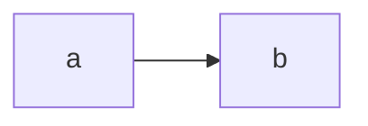

Open this page with `q2 preview` and edit it: cells update as you type, and
moving the slider survives edits elsewhere on the page.

A mermaid diagram, which should still draw:



```{ojs1}
viewof n = Inputs.range([0, 10], {value: 4, step: 1})
```

```{ojs2}
//| echo: false
const doubled = n * 2;
display(doubled);
```

```{ojs2}
display(`n cubed is ${n * n * n}`);
```
